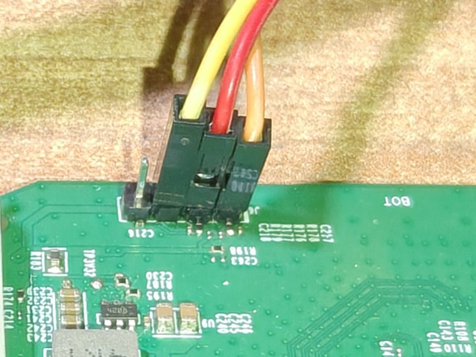

# OpenWrt for TP-Link EX530v

<p align="center">
  
  
  
  
  
  
</p>

OpenWrt port for the TP-Link EX530v v1 (AX3000 Wi-Fi 6 router, Airoha / EcoNet EN7523).
OpenWrt is installed into the **empty second firmware slot** and an unused NAND area, so
the stock firmware stays on the device and can be booted again with one U-Boot command.

Working: 3x LAN + WAN (Gigabit), Wi-Fi 2.4 GHz + 5 GHz (HE160), LuCI, USB storage, correct
MAC address and Wi-Fi calibration from flash, wired hardware NAT (PPE flow offload), Wi-Fi
offload the way the stock firmware does it (NPU for Wi-Fi RX, WED for Wi-Fi TX, PPE-bound
flows to Wi-Fi), sysupgrade (also from LuCI), boot from flash without a PC.

Prebuilt images are on the [Releases](../../releases/latest) page.

> **Unofficial.** This board is not in upstream OpenWrt. The first installation needs a
> serial console. Take a full flash backup first (see below). You do this at your own risk.

## Hardware

| Component | Details |
|---|---|
| SoC | Airoha / EcoNet EN7523 (EN7562CT), dual-core ARM, running in 32-bit ARMv7 mode |
| RAM | 512 MiB (496 MiB usable) |
| Flash | 512 MiB SPI-NAND, Micron MT29F4G01ABAFD (256 KiB eraseblock, 4 KiB page) |
| Wi-Fi | MediaTek MT7916 on PCIe, 2.4 GHz + 5 GHz 802.11ax (`mt7915e`), up to 160 MHz |
| Ethernet | 4x GbE: `lan1`, `lan2`, `lan3`, `wan` |
| USB | 1x USB port |
| Serial | `ttyS0`, 115200 8N1, 3.3 V (see [Serial console](#serial-console-uart)) |
| Bootloader | vendor EcoNet U-Boot 2014 (`ECNT>` prompt), dual-image (A/B) |
| Stock firmware | Linux 4.4.115, slot A only (slot B is empty from the factory) |

The MAC address is read from the `misc` partition (`0x8f100`), the MT7916 calibration
data from `misc` + `0x100000` (4 KiB). Nothing unit-specific has to be copied by hand.

## Status

| Feature | Status |
|---|---|
| Boot from flash (slot B), root on UBI, overlay on UBIFS | ✅ |
| sysupgrade (CLI and LuCI, settings kept) | ✅ |
| LAN 1-3 / WAN | ✅ |
| Wi-Fi 2.4 GHz (HE20) / 5 GHz (HE160, 2401 Mbit/s link) | ✅ |
| Wired NAT hardware offload (PPE) | ✅ ~890 Mbit/s routed, CPU 1-7 % |
| Wi-Fi offload (NPU RX, WED TX, PPE fast path) | ✅ 2 GB download to a phone at ~58-70 MB/s, CPU ~65-75 % per core, no core at 100 % |
| NPU (4x RV32, OpenNPU firmware) | ✅ Wi-Fi RX offload for the MT7916 |
| USB storage (ext4, vfat, exFAT, NTFS3) | ✅ |
| LuCI | ✅ |
| xPON | disabled |
| LEDs, buttons | not tested |

## Default configuration of the release image

| Setting | Value |
|---|---|
| LAN | `lan1`..`lan3`, `192.168.1.1`, DHCP server |
| WAN | `wan` port, DHCP client |
| Login | `root`, **no password** |
| Wi-Fi | **enabled and open (no password)**: `EX530v-OpenWrt-2G` (ch 1, HE20) and `EX530v-OpenWrt-5G` (ch 36, HE160), country `TR` |
| Flow offload | software + hardware flow offloading enabled |
| Wi-Fi offload | `options mt7915e wed_enable=1` (WED on, required by the NPU), NPU firmware `en7523_kite_npu_*.bin` |

> **Right after the first boot:** set a root password and Wi-Fi passwords. Until you do,
> anyone in range can join the open Wi-Fi and log in as root.

These defaults are applied once on first boot by [`files/etc/rc.local`](files/etc/rc.local);
later changes in LuCI are kept. The 5 GHz radio starts about one minute after boot (160 MHz
on channel 36 covers DFS channels, so a radar check runs first).

## Serial console (UART)

<p align="center"></p>

4-pin header on the board edge, next to `C216` (the `BOT` side). From left to right as in
the photo:

| Pin | Signal | Wire in the photo |
|---|---|---|
| 1 | 3.3 V | not connected |
| 2 | GND | yellow |
| 3 | RX | red |
| 4 | TX | orange |

115200 8N1, 3.3 V. Do not connect the 3.3 V pin. If you see no output, swap RX and TX.

## Installation (UART + TFTP, tested)

You need a USB-TTL serial adapter (3.3 V), an Ethernet cable and a TFTP server.
Download from the release: `…-initramfs-kernel.bin` and `…-squashfs-sysupgrade.bin`.

### 1. Boot OpenWrt from RAM

Give the PC the address `192.168.1.100/24` (the U-Boot default `serverip`) and connect it
to a LAN port. Put `openwrt-…-initramfs-kernel.bin` in the TFTP root, renamed to
`ex530v.itb`.

Power on and press a key within one second to stop autoboot at the `ECNT>` prompt, then:

```
tftpboot 0x84000000 ex530v.itb
bootm 0x84000000
```

Load at `0x84000000`. The default load address (`0x81800000`) is too close to the kernel
and the boot fails with `new format image overwritten`.

Nothing is written to flash. A power cycle brings the stock firmware back. OpenWrt is now
at `192.168.1.1` (SSH, no password).

### 2. Back up the flash

Copy every partition to the PC and keep the checksums. `misc` holds your MAC address and
Wi-Fi calibration and is unique to your unit.

```sh
# on the PC
ssh root@192.168.1.1 cat /proc/mtd > proc_mtd.txt
for i in $(seq 0 9); do
  ssh root@192.168.1.1 "cat /dev/mtd$i" > mtd$i.bin
  echo "$(ssh root@192.168.1.1 "md5sum < /dev/mtd$i" | cut -c1-32)  mtd$i.bin"
done > CHECKSUMS.md5
md5sum -c CHECKSUMS.md5   # macOS: compare with `md5 -r mtd*.bin`
```

### 3. Install with sysupgrade

```sh
scp -O openwrt-…-squashfs-sysupgrade.bin root@192.168.1.1:/tmp/
ssh root@192.168.1.1 sysupgrade -n /tmp/openwrt-…-squashfs-sysupgrade.bin
```

That is all. sysupgrade formats the UBI area (it is blank on a stock unit), writes the
kernel into slot B and the root file system into UBI, then switches the vendor boot flag
to slot B and reboots. The device comes up as OpenWrt at `192.168.1.1` and boots it on
every power-up from then on. The serial log shows `Prepare to boot image1`.

The stock firmware in slot A, the bootloader and `misc` are not written.

### Going back to stock

At the `ECNT>` prompt:

```
flash bflag 0
reset
```

Slot A was never written, so the stock firmware boots exactly as before. `flash bflag 1`
switches back to OpenWrt.

> **Do not use `bootflag swap`.** It writes a different flag at `0x1bfc0000` that the
> autoboot never reads (see [docs/u-boot.md](docs/u-boot.md)). `flash bflag` is a hidden
> sub-command; it does not appear in `help flash`.

## Updating

Use sysupgrade as on any OpenWrt device, from LuCI (*System → Backup / Flash Firmware*) or:

```sh
sysupgrade /tmp/openwrt-…-squashfs-sysupgrade.bin
```

Settings are kept unless you pass `-n`. The image is checked before flashing: it must be a
NAND sysupgrade tar for `tplink,ex530v-v1` whose kernel carries the TP-Link slot header.

## Flash layout

Stock `/proc/mtd` (from the stock firmware):

```text
dev:    size   erasesize  name
mtd0: 05980000 00040000 "whole"
mtd1: 00080000 00040000 "boot"
mtd2: 00040000 00040000 "romfile"
mtd3: 00400000 00040000 "misc"
mtd4: 00800000 00040000 "kernel"
mtd5: 02000000 00040000 "rootfs"
mtd6: 02800000 00040000 "firmware"
mtd7: 00800000 00040000 "kernel_slave"
mtd8: 02000000 00040000 "rootfs_slave"
mtd9: 02800000 00040000 "firmware_slave"
mtd10: 00040000 00040000 "reserve"
```

OpenWrt `/proc/mtd`:

```text
dev:    size   erasesize  name
mtd0: 00080000 00040000 "boot"
mtd1: 00040000 00040000 "romfile"
mtd2: 00400000 00040000 "misc"
mtd3: 00800000 00040000 "stock_kernel"
mtd4: 02000000 00040000 "stock_rootfs"
mtd5: 00800000 00040000 "kernel"
mtd6: 02000000 00040000 "stock_rootfs_slave"
mtd7: 00040000 00040000 "reserve"
mtd8: 16640000 00040000 "ubi"
mtd9: 00040000 00040000 "bootflag"
```

| Range | Stock | OpenWrt |
|---|---|---|
| `0x0000000` boot, `0x0080000` romfile, `0x00c0000` misc | bootloader, MAC, Wi-Fi calibration | read-only |
| `0x04c0000` kernel + `0x0cc0000` rootfs (slot A) | stock firmware | read-only, kept as fallback |
| `0x2cc0000` kernel_slave (slot B, 8 MiB) | empty | **OpenWrt kernel** (`kernel`) |
| `0x34c0000` rootfs_slave (32 MiB) | empty | unused, read-only |
| `0x5940000` reserve | vendor boot flag (blank on a new unit) | `reserve`, boot flag set by sysupgrade |
| `0x5980000` .. `0x1bfc0000` (358 MiB) | not mapped, erased | **UBI**: `rootfs` + `rootfs_data` |
| `0x1bfc0000` | flag of the U-Boot `bootflag` command | `bootflag` (not used for booting) |
| `0x1d740000` .. end | U-Boot BMT pool (`RAWB` / `BMT` tables) | **never mapped or written** |

How the vendor U-Boot chooses a slot is described in [docs/u-boot.md](docs/u-boot.md).

## Wi-Fi datapath (NPU + WED)

Same split as the stock firmware (worked out from its `hw_nat.ko`, `mt_whnat.ko`, `npu.ko`
and `mt7916_ap.ko`), see [docs/wifi-offload.md](docs/wifi-offload.md):

- **Wi-Fi to WAN (upload):** the NPU reads the MT7916 RX ring, reorders block-ack
  sessions and pushes frames into the PPE through QDMA0 TX ring 6. Bound flows leave on the
  WAN port without touching the ARM cores.
- **WAN to Wi-Fi (download):** the PPE binds the flow (NAT, L2 rewrite) and hands it to the
  CPU on CDM1; a short fast path in `airoha_eth` queues it straight to the Wi-Fi device
  (no GRO, routing or netfilter), and mt76 transmits it through the WED TX ring. The stock
  firmware does the same (`dp=0` + `PpeWifiFastTxHandler`); it does not bind Wi-Fi flows
  PPE -> WDMA.

Fast path counters: `/sys/module/airoha_eth/parameters/en7523_wifi_fp_*`. NPU: 
`/sys/kernel/debug/airoha_npu/`, `dmesg | grep "NPU RX"`.

## Building from source

The release was built from the
[sirherobrine23 Airoha OpenWrt fork](https://sirherobrine23.com.br/airoha/openwrt), commit
`eca3d0b` (2026-11-19), kernel 6.18.55.

1. Copy [`target/linux/airoha/dts/en7523-tplink_ex530v_v1.dts`](target/linux/airoha/dts/en7523-tplink_ex530v_v1.dts)
   into the same path in the tree.
2. Apply [`openwrt/airoha-ex530v.diff`](openwrt/airoha-ex530v.diff) (`git apply`): image
   recipe (TP-Link slot B header, NAND sysupgrade tar), sysupgrade handler (UBI format on
   first install, vendor boot flag), forced kernel command line, network setup, kernel
   text offset patch, and the Wi-Fi offload patches:
   - `9991` Wi-Fi fast path (PPE-bound flows from CDM1 straight to the Wi-Fi device)
   - `9992` WED: MT7916 WPDMA base on EN7523, TXD size check
   - `9993` NPU: allow `HWNAT_INIT` for the OpenNPU firmware
   - `9994` reserve QDMA0 TX ring 6 / TX IRQ queue 1 for the NPU
   - `9995` Wi-Fi flows use the CDM1 fast path, bridge with a Wi-Fi port counts as Wi-Fi
   - mt76 `0302` (NPU build fixes), mac80211 `423` (forward path for APs without a
     hardware path)
3. Optional: copy [`files/`](files) to the tree root for the defaults listed above.
4. `cp openwrt/diffconfig .config && make defconfig && make -j$(nproc)`.

Output: `…-initramfs-kernel.bin` (RAM boot) and `…-squashfs-sysupgrade.bin` (install /
upgrade). `…-slotb-kernel.bin` and `…-rootfs.squashfs` are the two parts of the
sysupgrade image, for manual flashing.

## Repository layout

| Path | Contents |
|---|---|
| `target/linux/airoha/dts/en7523-tplink_ex530v_v1.dts` | device tree |
| `openwrt/airoha-ex530v.diff` | changes to the OpenWrt tree |
| `openwrt/diffconfig` | build configuration |
| `files/` | first-boot defaults used in the release image |
| `docs/u-boot.md` | vendor U-Boot: slot selection, image header, boot flags |
| `docs/wifi-offload.md` | stock vs. OpenWrt Wi-Fi datapath, NPU bring-up notes |

## License

[GPL-2.0](LICENSE), the same as OpenWrt and the Linux kernel.
